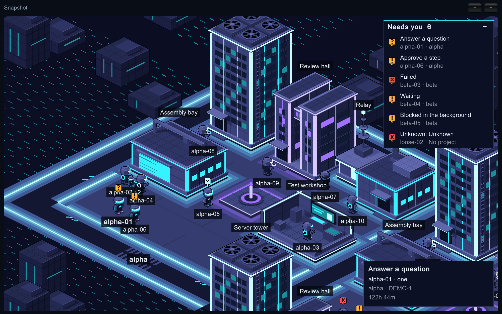
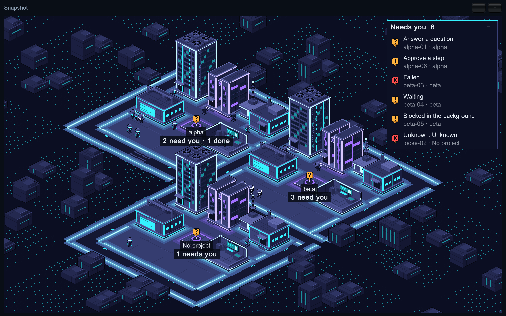
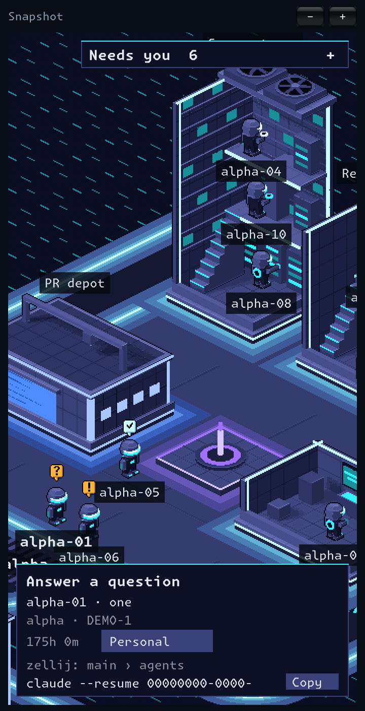
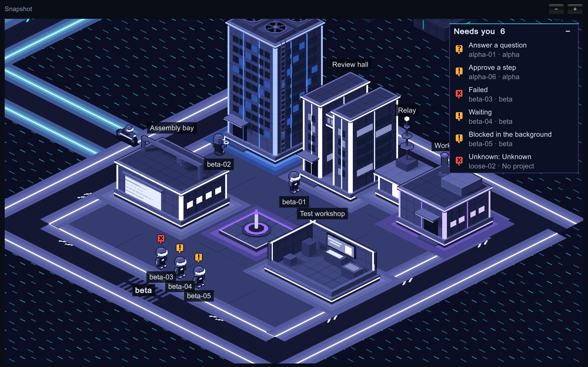

# The Grid

> **Note (2026-11-10):** parts of this document are superseded by the approved product requirements. The world is now isometric 16-bit pixel art; version 1 observes the messages agents already send rather than delivering them; seeing which agents are idle is the primary feature; and the order of work has changed. Where this document and the requirements differ, the requirements win. A public summary of the requirements will be added to this repo.

An open-source Unity desktop world where people share a repo sector, watch their coding agents work, and let specific agents exchange addressed messages across providers.

## Start here

This is an implementation starter. The included Unity component plays a fixed recording. It opens no network connection, reads no real session history, and spends no provider tokens. The collector, relay, installers, and live messaging described below are implementation work.

1. From this folder run `python3 tools/check_replay.py`. Expect two actors, ten events, and two correlated deliveries.
2. Open this folder as a project in Unity 6 (pinned in `ProjectSettings/ProjectVersion.txt`). Open `Assets/TheGrid/Demo.unity` and press Play. Use a Game view at least 800 pixels wide.
3. Step with **Next event**. Alex edits, asks Sam’s agent for a review, and receives a reply. A pulse travels on each delivery. Sam goes offline. Replay resets both actors. Names and message text here are synthetic.
4. Read [the agent brief](AGENT_HANDOFF.md), [the architecture](docs/architecture.md), [the transport contract](docs/protocol.md), and [the acceptance plan](docs/delivery.md).
5. First implementation issue: prove a real supported send-and-reply path between two different agent apps. Record versions, exact capabilities, and failure behavior. Then connect observation and transport to Unity.

## The roster

The first working piece: a window that lists your live Claude Code sessions on this Mac, with the one that needs you most on top. It reads what Claude Code already publishes about its own sessions and never writes to an agent app's files. The Grid's own code makes no network calls; it does run the `claude` program to ask for the session list.

- **Run it in the editor:** open the project in Unity 6000.4.3f1, open `Assets/TheGrid/Roster.unity`, press Play.
- **Build the app:** menu **The Grid > Build Mac App**, then open `Builds/TheGrid.app`.
- **Run the tests:** menu **The Grid > Run Core Tests**; results appear in Unity's Test Runner window and in `TestResults.xml` in the app's data folder. With the editor closed:

  ```bash
  /Applications/Unity/Hub/Editor/6000.4.3f1/Unity.app/Contents/MacOS/Unity -batchmode -nographics -projectPath "$PWD" -runTests -testPlatform EditMode -assemblyNames TheGrid.Core.Tests -testResults Logs/editmode.xml
  ```

The first time a build runs, macOS asks whether The Grid can access folders such as Documents, because your repos live there. Until you answer, the roster shows an error saying `claude agents did not answer`. It asks once: **Build Mac App** signs every build with the first Apple Development certificate in your keychain (Xcode creates one for any Apple account, free or paid), so a rebuilt app is still the same app to macOS. To sign with a different certificate, put its name or SHA-1, as `security find-identity -v -p codesigning` prints it, on one line in `UserSettings/TheGridSignIdentity.txt`; that folder is not tracked. With no certificate at all the build is left unsigned and macOS asks again after every rebuild. Run one copy at a time: two open copies with different signatures, such as an older unsigned build beside a new signed one, are one app by name but not by identity, and macOS then asks over and over until one of them is closed.

Each row shows the state (question, permission, done, running and so on), what a running agent is doing (reading, editing, testing, reviewing, or just working when it cannot be told), the session name, its account, how long it has been in that state, the repo, the ticket read from the branch name, the pull request, and the workspace. Click the pull request to open it. Click the workspace to move the repo to the next one.

Settings live in `~/Library/Application Support/DefaultCompany/The Grid/settings.json`, created on first launch. Edit the file to add workspaces; the app re-reads it the next time you click a workspace.

| Field | Meaning |
|---|---|
| `configDirs` | Claude config directories to read. Empty means `~/.claude` and every `~/.claude-*` that has a `projects` folder |
| `claudePath` | Path to the `claude` program. Empty means look in `~/.local/bin`, `/opt/homebrew/bin` and `/usr/local/bin` |
| `workspaces` | Workspace names, in the order a click cycles through them. Starts as `Personal` |
| `repoWorkspaces` | Which repo belongs to which workspace. A repo not listed is `Personal` |

## The review pile

Beside the roster, the window lists every message your Claude Code sessions sent each other on this Mac, newest first, once each. The Grid only observes these messages. It never sends, changes or deletes one.

- At 720 points or wider the roster is on the left and the pile on the right, under **Lists**. Narrower, they are two tabs: **Agents** and **Messages**. **World** is beside them either way.
- Each row shows who sent it, who received it, how long ago, and the sender's summary or the first line. Click the names to read the whole message; it is read from the session's transcript at that moment.
- Tick a message once you have reviewed it. **Clear ticked** archives the ticked rows: they leave the list and stay archived. **Tick shown** ticks every row on screen, which helps with the backlog on first launch; once they are all ticked the same button reads **Untick shown** and takes the ticks back.
- A row drawn in red, starting with two workspace names such as `Work → Personal`, is a message whose sender and recipient repos belong to different workspaces. A message is only flagged once both its sent and its received record have been found.
- A session's exchanges with its own subagents are not listed.

Clearing changes The Grid's own list and nothing else. The pile lives in `pile.json` beside `settings.json`. It holds, for each message, the two session names and repos, the time, the summary, the first line and where the full text can be read, plus how far each transcript has been read, so a transcript is not read twice. It holds no full message text. Nothing is written under a Claude config directory. Deleting `pile.json` rebuilds the list from the transcripts with every message unticked; on this Mac that first read took 9 seconds for 3.4 GB of transcripts.

The shape of the data the window draws is described in [docs/roster-snapshot.md](docs/roster-snapshot.md).

## The world

**World** shows the same agents as the roster, as bots in a city. Every repo gets a sector on one isometric map, and the map grows as new repos turn up. A bot stands at the building that matches the work its agent is doing, and walks to another when that changes. Nothing else moves, except the badge that bounces over every bot that needs you.



A building stands for a kind of work:

| Building | A bot is here when its agent is |
|---|---|
| Server tower | reading or searching |
| Assembly bay | editing files |
| Test workshop | running tests. Its near walls are cut away, so you see the bot at its terminal |
| Review hall | looking at diffs, commits or a pull request |
| Works | working, when it cannot be told on what |

Anything else is shown on the bot itself, wherever it stands:

| On the bot | Its agent is |
|---|---|
| Amber **?** badge | blocked on a question to you |
| Amber **!** badge | waiting for a permission, or on something else |
| Red **×** badge | errored, or in a state The Grid does not know |
| Pale **✓** badge | done with its turn |
| No light at all | offline |

Bots that need you stand in the open at the front left of their sector, done ones by the fountain, offline ones in front of the relay. The view opens on the first sector with a bot that needs you, close enough to follow one bot from a doorway to a workstation; in a small window it makes sure that bot is in view.



A lane runs round every sector, so between any two neighbours there is one, and the lanes of the whole map join up. Past the last sector the city carries on to the edge of the window as dark blocks. Lanes and blocks are scenery, worked out from where the sectors are; they say nothing about any agent.

- **Move:** drag, or scroll with two fingers.
- **Zoom:** the **−** and **+** buttons, the `-` and `+` keys, or scroll while holding Command. There are five levels, each double the last.
- **Far out,** each sector shows its name, how many bots need you and how many are done. **Closer in,** buildings and bots are named. The colour of a bot's light (blue, white or orange) is its account: an account gets the next colour the first time it is seen, and keeps it. Small bots beside a bot are its subagents.
- **Click a bot** to see its card.

Two panels lie over the map, down its right side:

- **Needs you** lists every bot that is waiting on you, most urgent first, with what it wants: an answer, an approval, or a look at a failure. Click a row and the view goes to that bot and selects it. Click the title to fold the list away; in a narrow window it starts folded.
- **The card** of the selected bot says what it is doing, who it is, in which repo and on which ticket, for how long, and what each of its subagents is doing. Click its workspace to move the repo to the next one, as in the lists. When the agent has a pull request, **PR #n** opens it.



When a message from one agent reaches another, the world shows it arriving. Between two sectors a courier on a bike, in the sender's colours, rides the lanes from the sender's crossing to the recipient's; then a ring of violet light pulses under the recipient. Within one sector there is only the pulse. While it lasts the recipient holds a hand to its helmet. A courier is drawn over buildings, so you can follow it the whole way.



The Grid only shows deliveries: it sends nothing and holds nothing back. A message is shown once, if it was received after you opened the world and both its sender and its recipient are bots on the map. The review pile has every message, shown or not.

Which repo has which sector, and which account has which colour, is kept in `world.json` beside `settings.json`. A repo keeps its place and an account its colour for good, also after their sessions are gone; delete the file to start the map again. If its contents are damaged it is kept as `world.json.bad` and the map starts empty.

To look at the world without any agent sessions, start the app on a roster snapshot file. It then reads no agent data and writes nothing:

```bash
Builds/TheGrid.app/Contents/MacOS/"The Grid" -snapshot "$PWD/fixtures/world/snapshot.json"
```

Add `-shots <folder>` and it saves `far.png` and `near.png` there and quits; `-select <account>|<session id>` selects that bot for `near.png`, and `-messages <pile snapshot file>` (try `fixtures/world/messages.json`) shows its messages arriving and saves `courier.png` and `pulse.png` too. With the editor closed, **The Grid > Render World Pictures** does much the same without a window, into `Logs/`, though without the names and badges:

```bash
/Applications/Unity/Hub/Editor/6000.4.3f1/Unity.app/Contents/MacOS/Unity -batchmode -projectPath "$PWD" -executeMethod TheGrid.EditorTools.GridMenu.WorldPictures -quit
```

The sprites are made by a script; see [tools/art/README.md](tools/art/README.md).

## Package map

| Path | Purpose |
|---|---|
| Assets/TheGrid/GridReplay.cs | Small interactive 3D fixture viewer. No provider SDK dependency. |
| Assets/TheGrid/Demo.unity | Scene with GridReplay attached. Open it and press Play. |
| Assets/TheGrid/Core/ | Reads live sessions and builds the roster. No scene or editor code. |
| Assets/TheGrid/RosterApp.cs, Roster.unity | The roster window and its scene. |
| Assets/TheGrid/WorldView.cs | The world as the window sees it: the camera, moving and zooming, names and badges. |
| Assets/TheGrid/WorldStage.cs | The world's scene: ground, lanes, buildings, bots and the blocks beyond. |
| Assets/TheGrid/WorldPanels.cs | The two panels over the world: who needs you, and the selected bot's card. |
| Assets/TheGrid/WorldTraffic.cs | Messages arriving in the world: couriers and pulses. |
| Assets/TheGrid/Resources/Art/, tools/art/ | The sprites, and the Blender script that makes them. |
| Assets/TheGrid/Tests/ | EditMode tests for Core. |
| fixtures/ | Hand-written sample records and the pinned roster snapshot. |
| Assets/TheGrid/Resources/grid-demo.json | Ordered offline projection for two synthetic users, sessions, and messages. |
| tools/check_replay.py | Dependency-free contract check for the fixture. |
| docs/protocol.md | Live envelope, identifiers, transactions, failure handling, and proposed routes. |
| docs/architecture.md | Boundaries, data ownership, ingestion, scene behavior, coworker onboarding. |
| docs/delivery.md | Implementation sequence, acceptance cases, verification evidence and release checklist. |
| docs/references.md | Pinned upstream reference implementations and licensing notes. |

## First live demo

Two installations bind different local paths to one invite-only room. Alex runs Codex and Claude Code in the same clone. Sam runs Claude Code in another clone. Both clients see three distinct bots. Alex’s Codex addresses Sam’s Claude agent with a review request for a commit available to both. Sam’s agent returns a correlated reply. Both clients show the delivery, Sam can inspect the message, and either user can revoke access. Disconnect Sam while his agent is active and verify it becomes offline. Reconnect without duplicating the reply.

The Grid is a working name. Use original art, sound, terminology and logos. The starter includes no upstream code or brand assets.

## License

[GNU AGPL v3.0](LICENSE).
