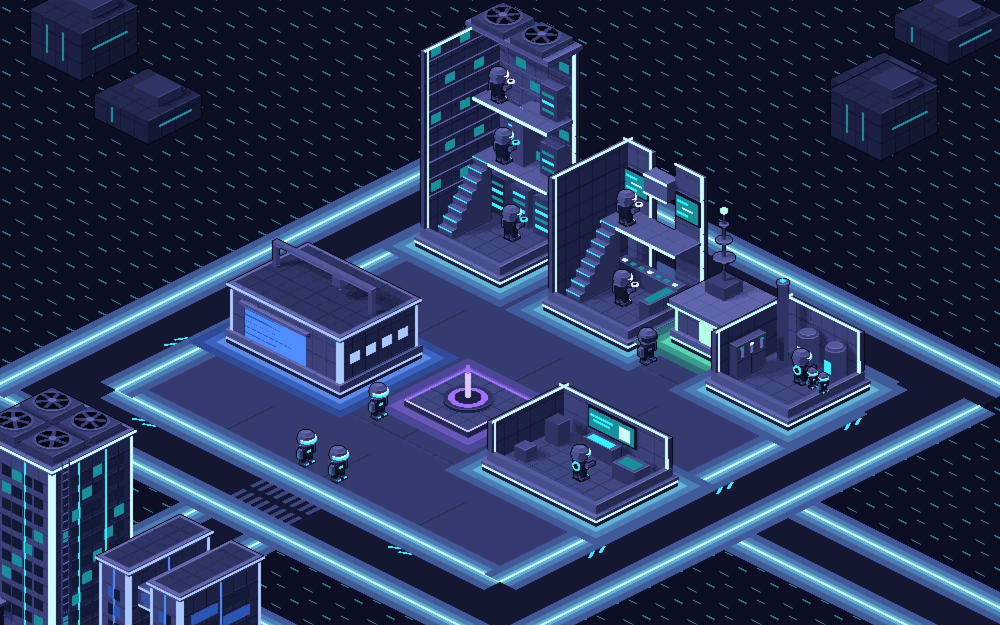
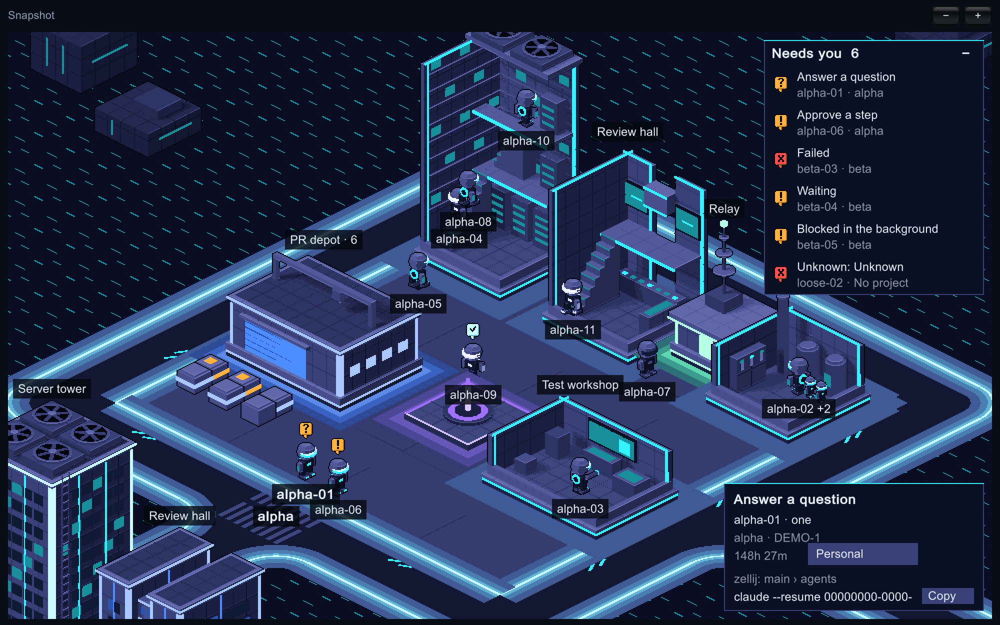
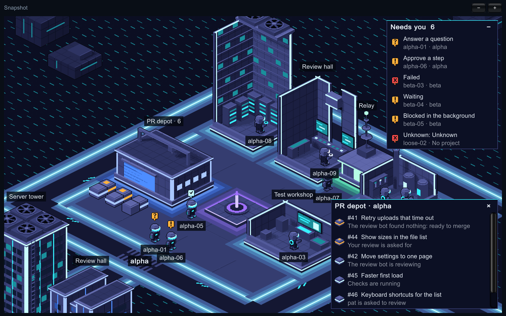
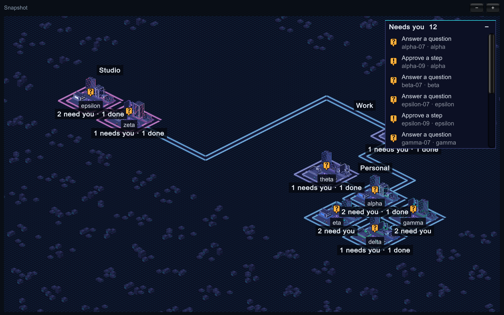
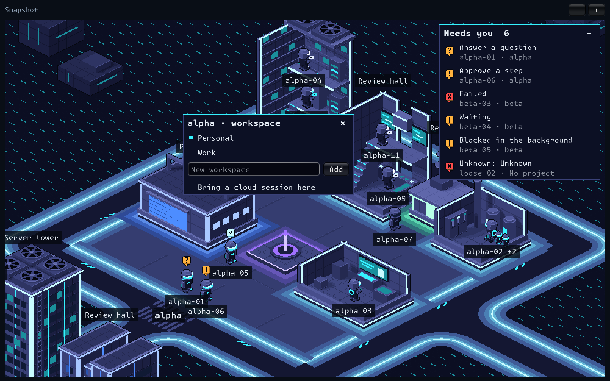
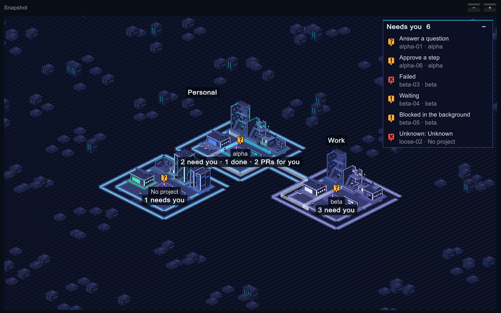

# The Grid

> **Note (2026-11-10):** parts of this document are superseded by the approved product requirements. The world is now isometric 16-bit pixel art; version 1 observes the messages agents already send rather than delivering them; seeing which agents are idle is the primary feature; and the order of work has changed. Where this document and the requirements differ, the requirements win. A public summary of the requirements will be added to this repo.

An open-source Unity desktop world where people share a repo sector, watch their coding agents work, and let specific agents exchange addressed messages across providers.

## Start here

This is an implementation starter. The included Unity component plays a fixed recording. It opens no network connection, reads no real session history, and spends no provider tokens. The collector, relay, installers, and live messaging described below are implementation work.

1. From this folder run `python3 tools/check_replay.py`. Expect two actors, ten events, and two correlated deliveries.
2. Open this folder as a project in Unity 6 (pinned in `ProjectSettings/ProjectVersion.txt`). Open `Assets/TheGrid/Demo.unity` and press Play. Use a Game view at least 800 pixels wide.
3. Step with **Next event**. Alex edits, asks Sam’s agent for a review, and receives a reply. A pulse travels on each delivery. Sam goes offline. Replay resets both actors. Names and message text here are synthetic.
4. Read [the agent brief](AGENT_HANDOFF.md), [the architecture](docs/architecture.md), [the transport contract](docs/protocol.md), and [the acceptance plan](docs/delivery.md).
5. First implementation issue: prove a real supported send-and-reply path between two different agent apps. Record versions, exact capabilities, and failure behavior. Then connect observation and transport to Unity.

## The roster

The first working piece: a window that lists your live Claude Code sessions on this Mac, with the one that needs you most on top. It reads what Claude Code already publishes about its own sessions and never writes to an agent app's files. The Grid's own code makes no network calls. It runs two programs of yours: `claude`, to ask for the session list, and `gh`, the GitHub command, to ask GitHub about the open pull requests of the repos on the map (see [The PR depot](#the-pr-depot); it can be turned off).

- **Run it in the editor:** open the project in Unity 6000.4.3f1, open `Assets/TheGrid/Roster.unity`, press Play.
- **Build the app:** menu **The Grid > Build Mac App**, then open `Builds/TheGrid.app`.
- **Run the tests:** menu **The Grid > Run Core Tests**; results appear in Unity's Test Runner window and in `TestResults.xml` in the app's data folder. With the editor closed:

  ```bash
  /Applications/Unity/Hub/Editor/6000.4.3f1/Unity.app/Contents/MacOS/Unity -batchmode -nographics -projectPath "$PWD" -runTests -testPlatform EditMode -assemblyNames TheGrid.Core.Tests -testResults Logs/editmode.xml
  ```

The first time a build runs, macOS asks whether The Grid can access folders such as Documents, because your repos live there. Until you answer, the roster shows an error saying `claude agents did not answer`. It asks once: **Build Mac App** signs every build with the first Apple Development certificate in your keychain (Xcode creates one for any Apple account, free or paid), so a rebuilt app is still the same app to macOS. To sign with a different certificate, put its name or SHA-1, as `security find-identity -v -p codesigning` prints it, on one line in `UserSettings/TheGridSignIdentity.txt`; that folder is not tracked. With no certificate at all the build is left unsigned and macOS asks again after every rebuild. Run one copy at a time: two open copies with different signatures, such as an older unsigned build beside a new signed one, are one app by name but not by identity, and macOS then asks over and over until one of them is closed.

Each row shows the state (question, permission, done, running and so on), what a running agent is doing (reading, editing, testing, reviewing, or just working when it cannot be told), the session name, its account, how long it has been in that state, the repo, the ticket read from the branch name, the pull request, and the workspace. Click the pull request to open it. Click the workspace to give the repo another: a short list opens with every workspace, the repo's own marked. Click one to move the repo there, or type a name in the last line and press Return (or **Add**) to make a new workspace and move the repo into it. **×**, Escape or a click beside the list puts it away.

Settings live in `~/Library/Application Support/DefaultCompany/The Grid/settings.json`, created on first launch. You do not need to edit it to add a workspace: the list does that. The app re-reads the file the next time you pick a workspace or click a region's name.

| Field | Meaning |
|---|---|
| `configDirs` | Claude config directories to read. Empty means `~/.claude` and every `~/.claude-*` that has a `projects` folder |
| `claudePath` | Path to the `claude` program. Empty means look in `~/.local/bin`, `/opt/homebrew/bin` and `/usr/local/bin` |
| `pullRequests` | `true` to ask GitHub, through `gh`, about open pull requests; `false` and the app asks nothing of the network. Starts as `true` |
| `ghPath` | Path to the `gh` program. Empty means look in `/opt/homebrew/bin`, `/usr/local/bin` and `/usr/bin` |
| `zellijPath` | Path to the `zellij` program, asked which tab a session is in. Empty means look in `~/.cargo/bin`, `/opt/homebrew/bin` and `/usr/local/bin` |
| `workspaces` | Workspace names, in the order the list shows them and regions take their lights. Starts as `Personal`; a workspace made in the app is added at the end |
| `repoWorkspaces` | Which repo belongs to which workspace. A repo not listed is `Personal` |
| `workspaceLights` | The light of a workspace's region in the world: `cyan`, `white`, `rose`, `mint`, `violet`, `blue` or `ember`. A workspace not listed takes its place in `workspaces`: the first is cyan, the second white, and so on |

## The review pile

Beside the roster, the window lists every message your Claude Code sessions sent each other on this Mac, newest first, once each. The Grid only observes these messages. It never sends, changes or deletes one.

- At 720 points or wider the roster is on the left and the pile on the right, under **Lists**. Narrower, they are two tabs: **Agents** and **Messages**. **World** is beside them either way.
- Each row shows who sent it, who received it, how long ago, and the sender's summary or the first line. Click the names to read the whole message; it is read from the session's transcript at that moment.
- Tick a message once you have reviewed it. **Clear ticked** archives the ticked rows: they leave the list and stay archived. **Tick shown** ticks every row on screen, which helps with the backlog on first launch; once they are all ticked the same button reads **Untick shown** and takes the ticks back.
- A row drawn in red, starting with two workspace names such as `Work → Personal`, is a message whose sender and recipient repos belong to different workspaces. A message is only flagged once both its sent and its received record have been found.
- A session's exchanges with its own subagents are not listed.

Clearing changes The Grid's own list and nothing else. The pile lives in `pile.json` beside `settings.json`. It holds, for each message, the two session names and repos, the time, the summary, the first line and where the full text can be read, plus how far each transcript has been read, so a transcript is not read twice. It holds no full message text. Nothing is written under a Claude config directory. Deleting `pile.json` rebuilds the list from the transcripts with every message unticked; on this Mac that first read took 9 seconds for 3.4 GB of transcripts.

The shape of the data the window draws is described in [docs/roster-snapshot.md](docs/roster-snapshot.md).

## The world

**World** shows the same agents as the roster, as bots in a city. Every repo gets a sector on one isometric map, and the map grows as new repos turn up. A bot stands at the building that matches the work its agent is doing, and walks to another when that changes. Nothing else moves, except the badge that bounces over every bot that needs you.

Every sector has the same six buildings and a fountain, but no two beside each other look alike: the buildings stand in a different order. Sectors stand apart, with open ground between them and a short link of road joining each to its neighbours.

Each workspace has a **region** of the map to itself. Its sectors stand together, and a wider stretch of open ground lies between one region and the next: at least eight tiles from lane to lane, where two sectors of one region are three apart. A region has a light of its own: its lanes, the lines on its ground and most of its buildings carry it, and a few buildings in every sector carry one of two accent colours instead. The open ground between and beyond the regions is the same everywhere. With one workspace there is one region, and the map is one spiral of sectors.


A building stands for a kind of work:

| Building | A bot is here when its agent is |
|---|---|
| Server tower | reading or searching |
| Test workshop | running tests. Its near walls are cut away, so you see the bot at its terminal |
| Review hall | looking at diffs, commits or a pull request |
| Works | editing files, or working when it cannot be told on what |

The sixth building, the relay, is where offline bots wait. The fifth is the PR depot: no bot works there.

A bot at work goes inside. While anyone works in a building it is drawn opened, the way the test workshop always is: its two far walls stand, its two near ones are cut down to a kerb, and you see the bot at the racks of the server tower, the screens of the review hall or the reactors of the works. Six fit inside; a seventh waits at the door. When the last one leaves, the building closes again.

**A tall building has floors.** The server tower has three and the review hall two; the works, a low building, has one. An upper floor runs along the back wall only and reaches two floor squares out from it, so the middle of the building is open to the roof and you see every floor at once. The six inside are spread over the floors. A bot walks to its place: in at the door, across the ground floor, up the stair on the left wall, and in the tower up a second stair along the back wall. It comes down the same way before it crosses the sector, and the building stays opened until it is out.

**The lights of a building someone is working in pulse**: its lines, windows and glow go a step dimmer and back, about once every second and a half. A sector where lights are pulsing has agents at work; one that is still has none. Nothing else on the map moves for it.





Anything else is shown on the bot itself, wherever it stands:

| On the bot | Its agent is |
|---|---|
| Amber **?** badge | blocked on a question to you |
| Amber **!** badge | waiting for a permission, or on something else |
| Red **×** badge | errored, or in a state The Grid does not know |
| Pale **✓** badge | done with its turn |
| No light at all | offline |

Bots that need you stand in the open at the front of their sector, done ones by the fountain, offline ones in front of the relay. The view opens on the first sector with a bot that needs you, close enough to follow one bot from a doorway to a workstation; in a small window it makes sure that bot is in view.

### The PR depot

Every sector has a depot, and in front of it one crate for each open pull request of its repo, whoever opened it:

| Crate | The pull request is |
|---|---|
| Amber band and lid | **for you**: ready to merge, or your review is asked for |
| A band in the depot's light | **in review**: checks running or failed, a reviewer or a review bot at work, changes asked for, review comments not yet answered, conflicts, or GitHub still working out whether it merges |
| No light | a **draft** |

Those for you stand nearest the door. The depot's name says how many are open, and far out a sector's line adds how many are for you. Click the depot for the list: every open pull request with the reason it is where it is, in words. Click a row to open it in your browser.



"Ready to merge" means nothing is left to wait for: not a draft, GitHub has confirmed it merges without conflicts, checks passed or none, no review asked of anyone, and either approved or no approval required. A review bot is read from its reactions on the pull request's description: eyes while it reviews, a thumbs-up when it found nothing. Review comments count as answered once the pull request's author has replied in a review after them, or the bot that left them has since given its thumbs-up; this goes by the latest review, so a reply on one thread answers for all.

**This is the one place The Grid reaches the network, and it does so through your own `gh`.** Every three minutes, and at once when a repo is new to the map, it runs `gh api graphql` in each repo's folder (and, once per repo, `gh repo view` to learn which repo and host the folder is) with one query, asked again page by page where a repo has more than fifty open: the repo's open pull requests, with their draft flag, review decision, requested reviewers, merge conflicts, check status, reactions and who wrote the latest review, and your GitHub login. `gh` works out which repo from the folder's git remote and signs the request with the login you gave it; The Grid never sees or stores a token. Nothing is written to GitHub. If `gh` is not installed or not signed in, or a repo has no GitHub remote, its depot is empty and the list says why. Set `pullRequests` to `false` in `settings.json` and nothing is asked at all; the app reads the file at its start, and again whenever you click a workspace or a region's name. A repo on a company's own GitHub is asked about there, never on github.com: `gh` says which host a folder's repo is on, and the question goes to that host by name.




A lane runs round every sector, and roads cross the open ground so that every sector can be reached from every other: a short link between two sectors side by side in one region, a longer road between regions, which bends twice where the two sectors it joins do not face each other squarely. Past the last sector the city carries on to the edge of the window as dark blocks. Lanes, roads and blocks are scenery, worked out from where the sectors are; they say nothing about any agent.

- **Move:** drag, or scroll with two fingers.
- **Zoom:** the **−** and **+** buttons, the `-` and `+` keys, or scroll while holding Command. There are five levels, each double the last.
- **Far out,** each sector shows its name, how many bots need you and how many are done, and with more than one workspace each region shows its workspace's name. Click a region's name to give it the next light; the choice is kept in `settings.json`. Click a sector's name to give its repo another workspace, from the same list as in the lists: this works for a repo with no session too, which has no row and no bot. A workspace with a repo in it has a region, so a new workspace gets a region and the next light the moment a repo is put in it, and the sector moves there. Drag a name to move what it names (below). **Closer in,** buildings and bots are named; where the two would overlap, the bot's name wins. The colour of a bot's light (blue, white or orange) is its account: an account gets the next colour the first time it is seen, and keeps it. Small bots beside a bot are its subagents.
- **Click a bot** to see its card.



Two panels lie over the map, down its right side:

- **Needs you** lists every bot that is waiting on you, most urgent first, with what it wants: an answer, an approval, or a look at a failure. Click a row and the view goes to that bot and selects it. Click the title to fold the list away; in a narrow window it starts folded.
- **The card** of the selected bot says what it is doing, who it is, in which repo and on which ticket, for how long, and what each of its subagents is doing. Click its workspace to give the repo another, as in the lists. When the agent has a pull request, **PR #n** opens it. Under that the card says how to get into the conversation. **The command** that opens it in a terminal: `claude attach <id>` for a background session, which has no window of its own, and `claude --resume <session id>` for any other. The card shows the end of it; **Copy** puts the whole of it on the clipboard, with the `cd` to the session's folder in front and, for an account other than the default one, its `CLAUDE_CONFIG_DIR`. If you have more than one account, the default account's command unsets that variable, so that it works from a terminal set up for another account. And, for a session that runs in a [zellij](https://zellij.dev) pane, **where it already is**: `zellij: <session> › <tab>`. Go there rather than run the command, which would open the conversation a second time. To find that, the app reads the environment of that one process when you click its bot (`ps`), keeps from it the zellij session's name and the pane's number and nothing else, and asks `zellij` for that session's panes. The app runs nothing in a terminal, and types nothing into a conversation and reads nothing from one.


When a message from one agent reaches another, the world shows it arriving. A courier on a bike, in the sender's colours, appears at the front of the sender's building, rides to the front of the recipient's, and rides back the way it came. Between two sectors it goes by the crossing, the lanes and the road, down the middle of them; over a plot it keeps to the street before the back row and the aisle between the two low buildings, and turns square corners. Between two bots of one sector it rides from the one front to the other. As it arrives, a ring of violet light pulses under the recipient, who holds a hand to its helmet while it lasts.

**Behind the courier stands a ribbon of light**, as tall as the bike and see-through, in the sender's colour. It stays for two minutes after the courier is back, fading in four steps, so a message you were not watching can still be read off the map, far out as well: who sent it, to whom, by which road. Bike and ribbon are drawn where they are: where the road runs behind a building, they are behind it.




The Grid only shows deliveries: it sends nothing and holds nothing back. A message is shown once, if it was received after you opened the world and both its sender and its recipient are bots on the map. The review pile has every message, shown or not. The app's log (`~/Library/Logs/DefaultCompany/The Grid/Player.log`) has a line for each message that arrived while the world was open: `[mail] courier: <sender> to <recipient>, through 2 sectors`, or `[mail] no courier:` and why.

Which repo has which sector, where every region and every sector stands, and which account has which colour, is kept in `world.json` beside `settings.json`. Nothing on the map moves unless you move it, also after its sessions are gone: a new region is put beside the map, a new sector on the nearest free place of its region. Delete the file to start the map again. Move a repo to another workspace and its sector goes to that region; no other sector moves.

You arrange the map yourself by dragging names:

- **A region:** far out, press on its name and drag. Dotted outlines show where its sectors would stand. Let go and it stays there.
- **A sector:** press on its name and drag. It goes from place to place of its region's own grid, so it always lines up with the region's other sectors.
- Where the outlines turn red the thing may not stand: on another sector, or nearer than the gap to another region. Let go there and it goes back.

To look at the world without any agent sessions, start the app on a roster snapshot file. It then reads no agent data and writes nothing:

```bash
Builds/TheGrid.app/Contents/MacOS/"The Grid" -snapshot "$PWD/fixtures/world/snapshot.json"
```

Add `-shots <folder>` and it saves `far.png` and `near.png` there and quits; `-select <account>|<session id>` selects that bot for `near.png`, and `-messages <pile snapshot file>` (try `fixtures/world/messages.json`) shows its messages arriving and saves `start.png`, `courier.png` and `pulse.png` too. `-pulls <file>` (try `fixtures/world/pulls.json`) puts those pull requests at the depots, since a snapshot never asks GitHub, and `-depot <sector name>` opens that depot's list in `near.png`. `-moved <world file>` lays the map again from that `world.json` after `far.png` and saves `moved.png`: a picture of a map its owner has arranged. `-workspace <sector name>` opens that sector's list of workspaces in `near.png`, and with `-give <workspace>` too the repo is given that workspace and `given.png` shows the map afterwards. `-where <text>` puts that on the selected bot's card as the place its session lives, since a snapshot never asks zellij. `-then <snapshot file>` (try `fixtures/world/later.json`) swaps the snapshot for a later one after `near.png` and saves `stairs.png` with every bot that has somewhere new to go three fifths of its way there. With the editor closed, **The Grid > Render World Pictures** does much the same without a window, into `Logs/`, though without the names and badges:

```bash
/Applications/Unity/Hub/Editor/6000.4.3f1/Unity.app/Contents/MacOS/Unity -batchmode -projectPath "$PWD" -executeMethod TheGrid.EditorTools.GridMenu.WorldPictures -quit
```

The sprites are made by a script; see [tools/art/README.md](tools/art/README.md).

## Package map

| Path | Purpose |
|---|---|
| Assets/TheGrid/GridReplay.cs | Small interactive 3D fixture viewer. No provider SDK dependency. |
| Assets/TheGrid/Demo.unity | Scene with GridReplay attached. Open it and press Play. |
| Assets/TheGrid/Core/ | Reads live sessions and builds the roster. No scene or editor code. |
| Assets/TheGrid/RosterApp.cs, Roster.unity | The roster window and its scene. |
| Assets/TheGrid/WorldView.cs | The world as the window sees it: the camera, moving and zooming, names and badges. |
| Assets/TheGrid/WorldStage.cs | The world's scene: ground, lanes, buildings, bots and the blocks beyond. |
| Assets/TheGrid/WorldPanels.cs | The two panels over the world: who needs you, and the selected bot's card. |
| Assets/TheGrid/WorldTraffic.cs | Messages arriving in the world: couriers, their ribbons, and pulses. |
| Assets/TheGrid/Resources/Art/, tools/art/ | The sprites, and the Blender script that makes them. |
| Assets/TheGrid/Tests/ | EditMode tests for Core. |
| fixtures/ | Hand-written sample records and the pinned roster snapshot. |
| Assets/TheGrid/Resources/grid-demo.json | Ordered offline projection for two synthetic users, sessions, and messages. |
| tools/check_replay.py | Dependency-free contract check for the fixture. |
| docs/protocol.md | Live envelope, identifiers, transactions, failure handling, and proposed routes. |
| docs/architecture.md | Boundaries, data ownership, ingestion, scene behavior, coworker onboarding. |
| docs/delivery.md | Implementation sequence, acceptance cases, verification evidence and release checklist. |
| docs/references.md | Pinned upstream reference implementations and licensing notes. |

## First live demo

Two installations bind different local paths to one invite-only room. Alex runs Codex and Claude Code in the same clone. Sam runs Claude Code in another clone. Both clients see three distinct bots. Alex’s Codex addresses Sam’s Claude agent with a review request for a commit available to both. Sam’s agent returns a correlated reply. Both clients show the delivery, Sam can inspect the message, and either user can revoke access. Disconnect Sam while his agent is active and verify it becomes offline. Reconnect without duplicating the reply.

The Grid is a working name. Use original art, sound, terminology and logos. The starter includes no upstream code or brand assets.

## License

[GNU AGPL v3.0](LICENSE).
