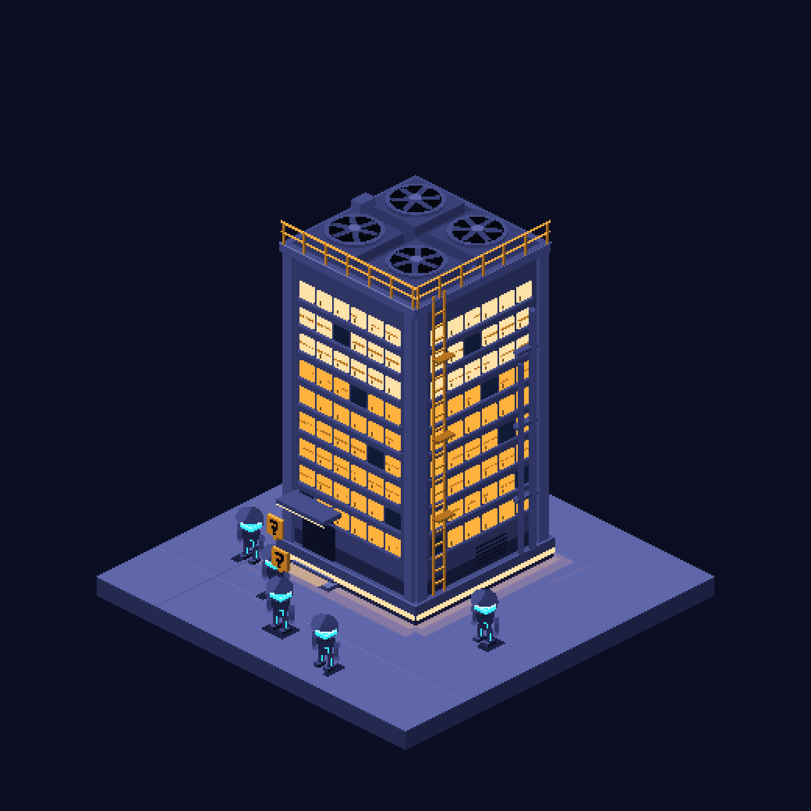
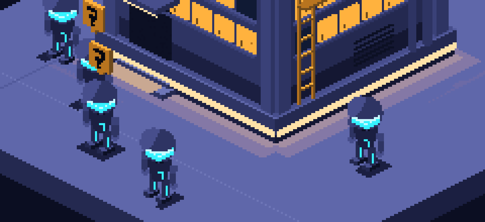
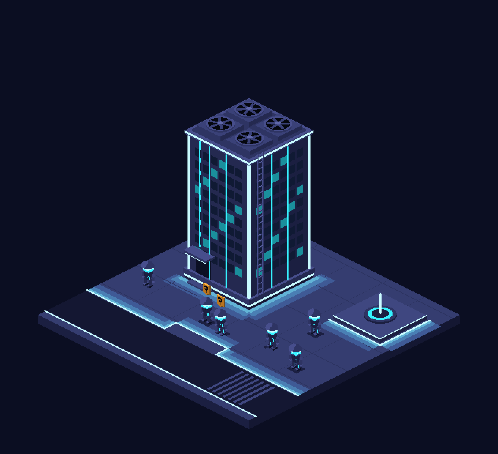

# Art direction

How The Grid should look. This is the target every sprite and every screen is judged against. It was set by the project's owner on 2026-11-11 and replaces the look of the first sprite set (navy boxes, riders on bikes, stones and lakes).

Three studies made with the project's own script show the direction. They are studies, not the shipped art.

## The brief

The Grid is a virtual city where each repository occupies a sector and each coding-agent session appears as a small helmeted bot.

**Camera and rendering.** Drawn like a classic 16-bit isometric management game. A fixed 2:1 isometric view, looking down on a compact, playable district. Chunky pixels, stepped diagonal edges, crisp silhouettes, distinct light and shadow faces. A sector is framed close enough to follow one bot from a doorway to a workstation.

**Materials and lighting.** The city is built from smooth, poured blue-gray concrete, dark graphite panels, and smoked glass. Pavement is broad and uninterrupted, with an occasional expansion joint. The buildings illuminate the paths: cyan-white strips are recessed under entrances, overhangs and foundation edges, and their light spills a short distance onto the concrete. The city is sterile: no cobblestones, trees, flowers, planters or freestanding streetlamps. Light is primarily blue, teal and white; another colour is allowed, but the lights on any one building are all the same colour.

**Where the detail goes.** Each building has a recognizable job. The server tower has cooling fans and a service ladder, the relay a compact antenna, the test workshop a cutaway wall so a bot can be seen at its terminal. Walking surfaces stay quiet. A small violet light fountain is the plaza's landmark, and a cyan lane runs round the perimeter.

**Characters and activity.** Bots are roughly two heads tall, with oversized, fully enclosed helmets, short legs and chunky boots. Their actions are legible through pose: a courier leans over a bike, a debugger inspects a disc, a relay touches its helmet receiver. An amber question badge marks an agent waiting on the user; a brief violet pulse marks a delivered message.

**Composition check.** At normal game zoom it must be possible to spot the two waiting bots, follow the courier's route, and identify the workshop by sight. The camera stays on the playable sector. No cinematic skylines, distant horizons, heavy bloom or photorealistic rendering.

## Rules added while studying it

1. **Pixel density is fixed.** A ground tile is 64 pixels wide and 32 high, the size classic tycoon games use. Detail comes from what is built at that grain, never from more pixels per tile. The world is looked at two or three screen pixels to the art pixel.
2. **Bots are people, not robots.** A bot is a person in a dark suit traced with light, under its helmet. At about 32 pixels tall a person is read from the gaps: between the legs, between arm and body, between helmet and shoulders.
3. **On buildings, light runs in long lines** up the corners and sides, unbroken from foot to roof and on round the roof edge. Windows are secondary to those lines.
4. **The ground is lit the same way:** dark paving in large squares, with long lines of light along kerbs, lane edges and the outlines of platforms, and their glow lying on the paving beside them. Glow is flat bands in palette colours, never a gradient.
5. **State is shown on the bot, not by a building.** Buildings stand only for kinds of work, plus the relay. Waiting, faulted, done and offline are a badge and a pose on the bot, wherever it stands.

## What stays from before

- Everything shown is true. Where a bot stands and what it is doing follows from the roster snapshot; nothing moves unless something really changed.
- One fixed palette, point filtering, no half-transparent pixels, whole-number scaling.
- All art is original and made by `tools/art/make_sprites.py`. Reference pictures are for how light and material behave only; no design or name is taken from them, and they are not kept in this repo.

## Words

In code and in the window: a repo's area is a **sector**, a session's figure is a **bot**, the road round a sector is the **lane**, the vehicle is a **bike**.
